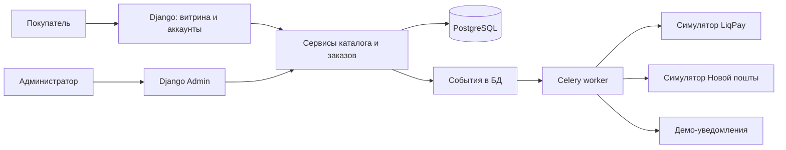

# План реализации магазина «Плин»

Дата: 15 октября 2026 года. Статус: планирование, реализация не начата.

## 1. Цель и принятые решения

Создать демонстрационный интернет-магазин кофе для портфолио Axon с архитектурой, которую можно развивать в рабочий магазин. Первую версию наполняем вымышленными данными; оплату и доставку симулируем на основе API реальных сервисов.

| Область | Решение |
| --- | --- |
| География | Только Украина |
| Язык и валюта | Украинский, гривна UAH — исходные настройки проекта |
| Покупатели | Оформление без регистрации и через аккаунт |
| Оплата | LiqPay, наложенный платёж, наличные или карта при самовывозе; все операции симулируются |
| Доставка | Новая пошта: отделения, почтоматы и курьер; симуляция справочников, расчёта, ТТН и отслеживания |
| Самовывоз | Одна точка в центре Одессы |
| Ассортимент | Один бренд, кофе в зёрнах и с выбором помола |
| Склад | Один склад, остатки по фасовкам |
| Управление | Админка для товаров, остатков, промокодов, заказов и контента |
| Размещение | В перспективе личный сервер Debian с Docker |

**Ограничение пользователя:** `dev-server-pwa` разрешено только читать. В рамках планирования выполнено чтение характеристик и списка контейнеров. Развёртывание, установка, создание файлов, запуск команд управления контейнерами и изменение конфигурации на сервере не разрешены. Этот план сам по себе не является разрешением на такие действия.

## 2. Демонстрационный бренд

- Рабочее название: **«Плин»**.
- Идея: небольшая одесская обжарка, кофе для спокойного ежедневного ритуала.
- Тон: простой, тёплый, без вымышленных наград, отзывов покупателей и показателей продаж.
- Визуальное направление: молочный фон, глубокий морской оттенок, терракотовые акценты, выразительная типографика и фотографии кофе и упаковки.
- Самовывоз: **«Одеса, центр, вул. Кавових Мрій, 7»**. Это намеренно вымышленный адрес; прямо обозначить это в интерфейсе. Не ставить реальную отметку на карте и не давать маршрут к чужому зданию.
- На сайте явно указать, что это демонстрационный магазин Axon и реальные заказы не исполняются.

Начальное наполнение: 12 сортов/блендов, фасовки 250 г, 500 г и 1 кг; зерно или помол под эспрессо, гейзер, фильтр, френч-пресс и турку. Подготовить товары в наличии, отсутствующие товары, акцию и промокоды с разными условиями для демонстрационных сценариев.

Название, визуальный стиль, состав каталога и точный вымышленный адрес — рабочие решения, которые можно менять без изменения архитектуры.

## 3. Стек и архитектура

Выбираем **модульный монолит**: витрина, аккаунты, оформление заказа и админка находятся в одном Django-проекте. Бизнес-правила вынесены в сервисы, общие для витрины, админки и интеграций.

| Задача | Технология и назначение |
| --- | --- |
| Сервер | Python 3.13, Django 5.2 LTS; модели, формы, сессии, права доступа |
| Витрина | Django Templates, HTMX, Tailwind CSS; серверный HTML и обновление отдельных блоков |
| Админка | Django Admin с адаптацией списков, форм и действий под работу магазина |
| База | Отдельный PostgreSQL 17 |
| Фоновые задачи | Celery и отдельный Redis; уведомления, симуляция событий, освобождение резервов |
| Выполнение по расписанию | Один Celery Beat; повтор задач и проверка просроченных резервов |
| HTTP-процесс | Gunicorn; статика через WhiteNoise, изображения отдельно |
| Файлы | Собственный Docker volume для медиа; интерфейс хранения с возможностью перейти на S3 |
| Сборка | Docker Compose; Node используется на стадии сборки CSS и клиентских ресурсов |
| Проверки | pytest / pytest-django и Playwright; интеграционные проверки на PostgreSQL |
| Автоматизация | CI: статический анализ, миграции, тесты и сборка образа |

Django 5.2 получает расширенную поддержку до апреля 2028 года; PostgreSQL 17 — до ноября 2029 года. На первом этапе зафиксировать актуальные исправленные версии и lock-файлы, затем обновлять зависимости регулярно. Конкретные версии HTMX, Tailwind и Celery проверить при создании проекта.

HTMX улучшает обычные ссылки и формы. Просмотр каталога, изменение корзины и отправка checkout должны иметь обычный серверный сценарий; интерактивность не должна становиться единственным способом купить товар.

Планируемые модули: `catalog`, `inventory`, `cart`, `promotions`, `checkout`, `orders`, `payments`, `shipping`, `accounts`, `notifications`, `content`, `demo`.

## 4. Пользовательские сценарии и экраны

### Витрина

- Главная: бренд, подборки кофе, способы приготовления, доставка.
- Каталог: поиск, фильтры по происхождению, обжарке и способу приготовления; сортировка, пагинация, параметры в URL.
- Карточка: фотографии, описание, вкусовые ноты, характеристики, фасовка, помол, цена, наличие.
- Корзина: изменение количества и вариантов, удаление, промокод, предварительный итог.
- Оформление: контакты, способ получения, отделение/почтомат/адрес или точка самовывоза, способ оплаты, итоговая сумма.
- Результат оплаты: успех, отказ, ожидание; возможность безопасного повтора.
- Страница заказа: состав, суммы, отдельные статусы заказа, оплаты и доставки.
- Информационные страницы: бренд, доставка и оплата, контакты, возвраты и конфиденциальность с пометкой о демонстрационном содержании.

### Аккаунты и гости

- Регистрация по email и паролю, подтверждение email, вход/выход, восстановление пароля.
- Личный кабинет: история заказов, детали заказа, профиль и сохранённые адреса.
- Гостевой заказ: имя, телефон и email; просмотр по защищённой ссылке с ограниченным сроком действия.
- Гостевые заказы не привязываются к аккаунту только по совпадению email. Привязка возможна после проверки владения адресом и подтверждения конкретного заказа.
- При входе объединять гостевую и пользовательскую корзины, повторно проверяя доступность и цену.

### Получение и оплата

| Получение | Онлайн LiqPay | Наложенный платёж | Оплата на месте |
| --- | --- | --- | --- |
| Отделение Новой пошты | Да | Да | — |
| Почтомат Новой пошты | Да | Только если выбранная услуга это допускает | — |
| Курьер Новой пошты | Да | Только если выбранная услуга это допускает | — |
| Самовывоз | Да | — | Наличные или карта |

В демо доступность услуг задаётся синтетическим справочником. Перед реальным подключением сверить комбинации с текущими возможностями перевозчика. Наложенный платёж моделируется как отдельный способ расчёта, а не как онлайн-платёж LiqPay.

Стоимость доставки и комиссия наложенного платежа показываются отдельно, с указанием плательщика. Синтетические тарифы подписаны как демонстрационные. Самовывоз бесплатный. Начальный демонстрационный порог бесплатной доставки — 1500 грн, изменяемый в настройках. При онлайн-оплате доставка оплачивается в составе заказа; при наложенном платеже — при получении. Расчёт не должен дважды включать доставку или комиссию.

### Административная работа

- Товары, фотографии, характеристики, фасовки, цены, публикация/архивирование.
- Остатки, корректировки и история движения товара.
- Промокоды: процент или фиксированная сумма, сроки, минимальная сумма, лимиты использования.
- Заказы: поиск, фильтры, детали, допустимые переходы статусов, внутренние комментарии.
- Создание демонстрационной ТТН, просмотр доставки, отмена и возврат с указанием причины.
- Подготовка самовывоза, выдача и подтверждение оплаты на месте.
- Роли владельца и менеджера; менеджер не меняет права, секреты и системные настройки.
- Журнал существенных действий: цены, остатки, статусы, возвраты.

В публичном демо не публиковать учётные данные владельца. Для показа админки предусмотреть ограниченный просмотр без изменения данных; полный сценарий управления показывать в локальном окружении.

## 5. Данные и правила заказа

Основные сущности:

| Группа | Сущности |
| --- | --- |
| Каталог | Product, ProductVariant, ProductImage, GrindOption, BrewingMethod |
| Остатки | StockItem, StockMovement, StockReservation |
| Покупки | Cart, CartItem, Order, OrderItem, OrderStatusHistory |
| Скидки | PromoCode, PromoRedemption |
| Оплата | PaymentAttempt, PaymentEvent, Refund |
| Получение | ShippingQuote, Shipment, ShipmentEvent, PickupLocation |
| Пользователи | User, CustomerProfile, Address, GuestOrderAccess |
| Эксплуатация | OutboxEvent, Notification, AuditLog |

Правила, которые реализуются до интеграций:

1. Денежные значения хранить целым числом копеек. Итог, округление скидки, доставка и комиссии рассчитываются сервером.
2. В `OrderItem` сохранять снимок названия, фасовки, помола, цены и скидки. Последующее редактирование товара не меняет историю покупки.
3. В первой версии SKU = кофе × фасовка. Помол — услуга к выбранной упаковке, которая не создаёт отдельный остаток. Продажи зерна и разных помолов расходуют общий остаток этой фасовки.
4. При checkout заново проверить цены, промокод, адрес/услугу и доставку. Изменившуюся сумму показать покупателю до подтверждения.
5. Создание заказа, резерв товара и лимита промокода выполнять атомарно с блокировкой нужных записей и ограничениями БД. Нельзя продать последнюю упаковку двум покупателям.
6. Онлайн-заказ получает резерв на 20 минут; срок настраивается. Неуспех или истечение освобождают резерв и лимит промокода. Граница срока и успешный callback обрабатываются под блокировкой.
7. Если успех оплаты пришёл после освобождения резерва, повторно проверить наличие. При отсутствии товара поставить заказ на разбор и инициировать демонстрационный возврат, не создавать отрицательный остаток.
8. Заказы с оплатой при получении подтверждаются и переводят резерв в выделенный товар; при отмене/неполучении товар возвращается по контролируемому переходу. Срок ожидания самовывоза — настраиваемый, исходно 3 дня.
9. Один ключ подтверждения checkout создаёт один заказ. Повторы оплаты, webhook, задач, возврата и создания ТТН не дублируют результат. Ключи и внешние идентификаторы имеют уникальные ограничения в БД.
10. Статусы заказа, оплаты и доставки независимы. «Выдан» или «доставлен» не означает автоматически «оплачен», особенно для наложенного платежа.
11. Статусы изменяются через доменные сервисы и разрешённые переходы, включая действия в Django Admin. Прямое редактирование финансовых полей и статусов запрещено.
12. Промокод один на заказ; не суммируется с другим кодом. Проверки лимитов и минимальной суммы выполняются сервером, правила сочетания с ценой по акции фиксируются в настройках.
13. Доступ к заказу требует владельца аккаунта, разрешённой роли или действующего гостевого токена. Номер заказа и email сами по себе доступа не дают.
14. События интеграций сначала сохраняются в БД. Outbox и повторяемые задачи позволяют восстановить обработку после перезапуска приложения, Redis или worker.

## 6. Симуляторы интеграций

Создать контракты `PaymentProvider`, `ShippingProvider` и `NotificationProvider`. В первой версии реализовать mock-адаптеры. Реальные адаптеры — отдельный последующий этап; переключение режима не заменяет разработку, проверку и подключение настоящей интеграции.

### LiqPay

- Воспроизвести используемую часть контракта: создание checkout, идентификатор заказа, сумму, валюту, подпись и серверное уведомление.
- Зафиксировать выбранную версию API и формат подписи по официальной документации перед реализацией; не смешивать примеры разных версий.
- Mock checkout показывает варианты «успех», «отказ», «ожидание», «отмена» и не собирает настоящие карточные реквизиты.
- Предусмотреть повторный/задержанный callback, неправильную подпись, несоответствие суммы/валюты/заказа, временную ошибку и возврат.
- Redirect покупателя сам по себе не подтверждает оплату: нужен проверенный серверный результат.
- Проверить полный возврат и его повтор. Частичные возвраты отложить.

### Новая пошта

- Воспроизвести используемую часть запросов/ответов: населённые пункты, отделения/почтоматы, стоимость и срок, создание/отмена отправления, статусы доставки.
- Использовать явно синтетический, ограниченный набор адресов и отделений; не выдавать его за актуальный справочник перевозчика.
- ТТН демонстрационная; ссылки не должны вести к отслеживанию чужих настоящих посылок.
- Сценарии: отправление создано, в пути, прибыло, получено, отказ/возврат; недоступная услуга, устаревший расчёт, таймаут и повтор создания.
- Не предполагать наличие входящих webhook у выбранного API: отслеживание проектировать через интерфейс получения статуса с опросом в фоне.

### Уведомления

В демо письма о регистрации, восстановлении пароля и статусах заказов попадают в локальный просмотрщик почты. SMS и реальные email не отправляются. Интерфейс уведомлений позволит позже подключить почтовый сервис; номер телефона используется для заказа и доставки, а не для SMS-входа.

Управление mock-сценариями доступно только в demo-режиме. В будущем live-режиме приложение должно отказываться запускаться с mock-провайдерами или демонстрационными ключами.

## 7. Этапы и критерии завершения

Этапы выполняются последовательно. Проверки бизнес-правил добавляются вместе с функциональностью; заключительный этап объединяет их в полный сценарий.

### Этап 1. Основа проекта

- [ ] Создать Django-проект, структуру модулей и настройки local/test/demo.
- [ ] Добавить зависимости, lock-файлы, Dockerfile и локальный Compose с собственной БД, Redis и просмотрщиком писем.
- [ ] Настроить CI, миграции, health checks, журналирование, `.env.example` без секретов.
- [ ] Определить контракт цен, остатков и переходов статусов, создать начальные модели и фабрики данных.

**Готово, когда:** проект запускается локально по README с чистой БД, проходит CI и не требует доступа к личному серверу или сервисам оплаты.

### Этап 2. Бренд, каталог и управление ассортиментом

- [ ] Создать адаптивную дизайн-систему и макеты главной, каталога, карточки, корзины и checkout.
- [ ] Реализовать каталог, фильтры, поиск, карточку и выбор фасовки/помола.
- [ ] Настроить Django Admin для каталога, изображений, остатков и информационных страниц.
- [ ] Подготовить синтетический каталог и команду повторяемого наполнения локального демо.

**Готово, когда:** товары управляются через админку, URL сохраняет фильтры, отсутствие товара понятно показано, витрина работает на телефоне и компьютере.

### Этап 3. Корзина и оформление

- [ ] Реализовать гостевую корзину, пересчёт и серверные промокоды.
- [ ] Добавить оформление с доставкой и самовывозом, матрицу допустимых способов оплаты.
- [ ] Реализовать создание заказа, снимки строк, резервы и защиту от повторного checkout.
- [ ] Покрыть расчёты, ограничения промокодов и конкурентную покупку последнего товара.

**Готово, когда:** гость оформляет заказ, итог подтверждается сервером, повтор запроса не создаёт второй заказ, остатки не уходят в минус.

### Этап 4. Аккаунты и доступ к заказам

- [ ] Добавить регистрацию, подтверждение email, вход и восстановление пароля.
- [ ] Реализовать кабинет, адреса, историю и объединение корзин.
- [ ] Добавить защищённые гостевые ссылки и подтверждённую привязку гостевого заказа.
- [ ] Проверить изоляцию покупателей, истёкшие ссылки, права менеджера и ограничение частоты запросов.

**Готово, когда:** доступны гостевой и зарегистрированный сценарии, покупатель не получает доступ к чужим заказам, письма проверяются в локальном просмотрщике.

### Этап 5. Оплата, доставка и обработка заказов

- [ ] Реализовать mock-адаптеры LiqPay и Новой пошты, фоновые задачи и outbox.
- [ ] Добавить ТТН, отслеживание, наложенный платёж, подготовку/выдачу самовывоза.
- [ ] Настроить разрешённые действия менеджера, отмены, полный возврат и журнал изменений.
- [ ] Проверить позднюю оплату, повтор callback, сбой worker, повтор ТТН и возврат неполученного товара.

**Готово, когда:** каждый способ получения и оплаты проходит полный цикл, повторы безопасны, перезапуск обработчика не теряет событие и не дублирует действие.

### Этап 6. Качество и подготовка размещения

- [ ] Провести E2E-проверки основных сценариев, адаптивности и управления с клавиатуры; исправить ошибки форм и контрастности.
- [ ] Добавить SEO-метаданные, оптимизацию изображений, sitemap и настройки индексации; публичное демо закрыть от индексации.
- [ ] Подготовить конфигурацию контейнеров с лимитами ресурсов, журналированием, health checks и отдельными volume.
- [ ] Документировать backup/restore БД и изображений, обновление, миграции и откат; проверить восстановление локально.
- [ ] Написать инструкцию будущего подключения к Traefik и проверить конфигурацию локально. На сервере ничего не применять.

**Готово, когда:** проверки проходят, свежий локальный запуск воспроизводим, восстановление из копии проверено, готова инструкция размещения с перечнем будущих изменений.

### Этап 7. Демонстрация и материалы Axon

- [ ] Подготовить ограниченный доступ к просмотру админки и сценарии демонстрации.
- [ ] Документировать запуск, переменные окружения, mock-сценарии и ограничения.
- [ ] Подготовить скриншоты, короткую видеодемонстрацию и описание кейса без вымышленных результатов.
- [ ] Сверить итог с критериями README и этим планом.

**Готово, когда:** пользователь проходит путь от выбора кофе до получения, менеджер управляет заказом, демо понятно посетителю, материалы готовы для портфолио.

Фактическое размещение на `dev-server-pwa` в эти этапы не входит: пользователь разрешил только чтение. После подготовки локального результата можно отдельно согласовать конкретное развёртывание.

## 8. Проверки, обязательные для первой версии

| Область | Что проверяем |
| --- | --- |
| Расчёты | Фасовки, количество, округление, скидки, порог доставки, комиссии, просроченный промокод |
| Конкуренция | Последний товар, последний доступный промокод, оплата на границе истечения резерва |
| Повторы | Checkout, оплата, callback, возврат, ТТН, фоновая задача |
| Доступ | Чужой заказ, подбор номера, гостевая ссылка, восстановление пароля, роль менеджера |
| Подделка | Цена с клиента, сумма/валюта callback, подпись, недопустимый переход статуса |
| Надёжность | Потерянный ответ, задержанное событие, worker/Redis недоступен, повтор после перезапуска |
| E2E | Гость + онлайн + отделение; аккаунт + наложенный платёж; самовывоз + наличные/карта; отказ и повтор оплаты; отмена и возврат |
| Интерфейс | Телефон/компьютер, клавиатура, пустая корзина, отсутствие товара, ошибки и ожидание |
| Эксплуатация | Чистый запуск, миграции, отсутствие секретов в репозитории, backup/restore |

Тесты конкурентности и блокировок выполняются на PostgreSQL. SQLite не заменяет эти проверки.

## 9. Личный сервер: прочитанные сведения и будущая схема

По результатам чтения 15 октября 2026 года:

- Debian 12, архитектура x86_64, 4 процессорных ядра.
- Около 16 ГБ общей RAM, около 11 ГБ доступно на момент проверки.
- На корневом диске около 330 ГБ свободно.
- Docker и Compose установлены, уже работают другие приложения.
- Публичные порты 80 и 443 заняты существующим Traefik.

Предварительная схема будущего размещения: отдельный Compose-проект магазина, собственные PostgreSQL/Redis/медиа и отдельный домен или поддомен. Подключение к существующему Traefik спроектировать после чтения его разрешённой конфигурации и выбора домена. Общие БД, Redis и хранилища других проектов не использовать.

Стартовый бюджет для будущего приложения — 2–4 ГБ RAM суммарно с ограничениями контейнеров; проверить нагрузкой локально и уточнить перед размещением. Это оценка, а не результат нагрузочного теста. Не публиковать наружу БД и Redis. Не занимать 80/443 новым reverse proxy.

На этапе подготовки создать инструкции и пример конфигурации только в локальном репозитории. На сервер не копировать файлы, не собирать образы, не запускать/останавливать контейнеры, не создавать сети или volume, не применять миграции и не менять Traefik/DNS.

## 10. Что отложено и что потребуется позже

После первой версии: реальные адаптеры LiqPay и Новой пошты, реальные email/SMS, частичные возвраты, подписки на кофе, отзывы, программа лояльности, несколько складов, дополнительные языки, интеграция с бухгалтерией.

Перед настоящими продажами потребуется отдельный этап: данные продавца и реальные адреса, договоры и ключи сервисов, проверка тарифов и доступности доставки, применимых правил торговли/налогообложения/фискализации, тексты условий и конфиденциальности, работа с персональными данными. Эти вопросы не считаются решёнными демонстрационным контентом.

Не блокируют начало локальной разработки: домен, почтовый провайдер, реальные ключи, окончательные цены и утверждённые изображения. Их выбор нужен перед соответствующими реальными интеграциями и размещением.

## Источники технических решений

- [Поддерживаемые версии Django](https://www.djangoproject.com/download/#supported-versions).
- [Версии и сроки поддержки PostgreSQL](https://www.postgresql.org/support/versioning/).
- [HTMX: документация и progressive enhancement](https://htmx.org/docs/#progressive_enhancement).
- [LiqPay: официальный API и формат checkout](https://www.liqpay.ua/doc/api/internet_acquiring/qr?tab=1).
- [Новая пошта: официальная страница интеграции и API](https://novaposhta.ua/en/for-business/cooperation/integration/).
